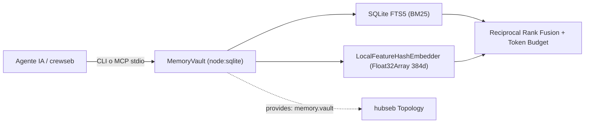
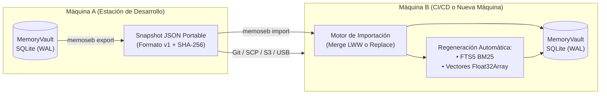
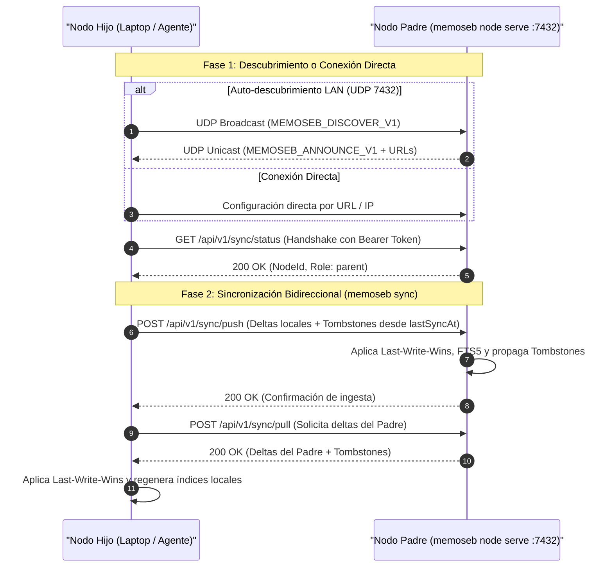

# memoseb

Una bóveda de **memoria híbrida multi-proyecto** (vectorial `Float32Array` + léxica `SQLite FTS5` con **Reciprocal Rank Fusion** y **presupuesto estricto de tokens**) para agentes de IA (**Antigravity CLI (`agy`)**, **Claude Code**, **Codex** y **OpenCode**).

Se conecta y registra automáticamente en [**hubseb**](https://github.com/PahesebPJ/hubseb) y potencia la memoria persistente de [**crewseb**](https://github.com/PahesebPJ/crewseb) mediante la capacidad `provides: ['memory.vault']`.

## Cómo funciona

- **Aislamiento Multi-Proyecto + Memoria Global**: Detecta automáticamente el proyecto activo inspeccionando la raíz de `package.json` o `.git` (o recibe `--project <id>`). Permite aislar el conocimiento de cada repositorio mientras comparte convenciones transversales en el proyecto `global`.
- **Análisis e Indexación Automática de Repositorios (`memoseb analyze`)**: Inspecciona manifiestos (`package.json`, `tsconfig.json`, `Cargo.toml`, `pyproject.toml`, `go.mod`, `Dockerfile`), estructura de directorios (`src/`), scripts, workflows CI y `README.md` para sintetizar y persistir automáticamente los 3 pilares base del proyecto (`architecture`, `convention` y `domain`).
- **Tokenización y Vectorización Local Zero-Dependency**: Construido íntegramente sobre `node:sqlite` (Node.js `>=22`) en modo WAL. Incluye `LocalFeatureHashEmbedder` (`local-feature-hash-v1`), un motor determinista de *feature hashing* con `FNV-1a` que proyecta palabras, prefijos, bigramas y trigramas de caracteres en vectores `Float32Array` normalizados (384 dimensiones) sin depender de APIs externas ni binarios nativos adicionales.
- **Búsqueda Híbrida RRF + Presupuesto de Tokens**: Combina similitud coseno densa (`memory_vectors`) y ranking léxico `BM25` (`SQLite FTS5`) mediante **Reciprocal Rank Fusion (RRF)** ponderada por importancia (`0.0` a `1.0`). Trunca automáticamente los resultados para respetar `--max-tokens` (por defecto `1200` tokens) sin saturar la ventana de contexto del agente.
- **Servidor MCP `stdio` + CLI `hubseb/v1`**: Expone un servidor JSON-RPC 2.0 sobre `stdio` (`memoseb mcp`) y una interfaz CLI compatible con el contrato `hubseb/v1` (`--json`), emitiendo señales en tiempo real (`memory.stored`, `memory.forgotten`, `memoseb.deployed`) a la topología de `hubseb`.



## Instalación (Para Humanos o Agentes de IA)

### Vía npm (Recomendado)

```sh
npm install -g memoseb
memoseb setup
```

### Desde código fuente (Desarrollo local)

```sh
git clone https://github.com/PahesebPJ/memoseb.git
cd memoseb
npm install
npm run build
memoseb setup
```

`memoseb setup` registra el nodo `memoseb` en la topología de `hubseb` (`~/.config/hubseb/topology.json`), despliega la skill `/memoseb` e inyecta las directivas globales (`rules/RULES.md`) verificadas con SHA-256 en los agentes detectados (`--agents claude,antigravity` elige cuáles, `--agents all` fuerza los 4).

## Comandos CLI

Todos los comandos aceptan `--json` para responder bajo el sobre estándar `hubseb/v1` y `--db <path>` (o la variable de entorno `MEMOSEB_DB_PATH`) para especificar la ruta de la base de datos SQLite.

```sh
memoseb setup [--agents a,b|all]             # Registra en hubseb e instala directivas/skills en los agentes
memoseb analyze [path] [--dry-run] [--json]  # Analiza un repositorio y guarda memorias de arquitectura, convenciones y dominio (alias: index, scan)
memoseb remember "<texto>" [opciones]        # Guarda o actualiza una memoria (alias: store)
memoseb recall "<consulta>" [opciones]       # Búsqueda híbrida BM25 + Vector + RRF (alias: search)
memoseb context [--max-tokens N]             # Briefing del proyecto activo dentro del presupuesto (alias: briefing)
memoseb projects [--json]                    # Lista los proyectos indexados, conteo de memorias y tokens
memoseb forget <id> [--json]                 # Elimina una memoria obsoleta por su ID
memoseb stats [--json]                       # Muestra métricas globales de la bóveda (proyectos, vectores, tokens)
memoseb export [file] [--project <id>]       # Exporta el cerebro a un snapshot JSON portable con checksum SHA-256
memoseb import <file> [--replace] [--project <id>] # Importa un snapshot JSON en otra máquina (merge LWW por defecto o --replace)
memoseb node status | enable | disable | discover | set-parent | add-child | remove | serve # Gestión opcional de red Padre ↔ Hijos
memoseb sync [--url <peer>] [--project <id>] [--full] # Sincronización bidireccional Padre ↔ Hijos
memoseb mcp                                  # Inicia el servidor MCP JSON-RPC 2.0 por stdio
memoseb check [--json]                       # Verifica la integridad SHA-256 de las directivas en cada host
memoseb uninstall [--json]                   # Purga archivos desplegados y desconecta el nodo de hubseb
memoseb capabilities [--json]                # Muestra capacidades (provides/consumes/signals) para hubseb
```

### Opciones de Comandos Principales

| Flag | Comandos | Descripción |
|---|---|---|
| `--dry-run` | `analyze` | Sintetiza los borradores de memoria del repositorio sin persistirlos en SQLite |
| `--category <cat>` | `remember`, `recall` | Categoría: `architecture`, `convention`, `bugfix`, `decision`, `domain` (por defecto `domain`) |
| `--title "<título>"` | `remember` | Título resumen (si se omite, se deriva de la primera línea) |
| `--tags <a,b,c>` | `remember`, `recall` | Etiquetas separadas por comas para filtrado y indexación FTS5 |
| `--importance <0..1>` | `remember` | Peso de relevancia entre `0.0` y `1.0` (por defecto `0.5`) |
| `--project <id>` | `analyze`, `remember`, `recall`, `context`, `export`, `import`, `sync` | Sobrescribe el identificador del proyecto (usa `global` para memorias compartidas) |
| `--agent <id>` | `analyze`, `remember` | Identificador del agente o especialista de `crewseb` que origina el recuerdo |
| `--limit <N>` | `recall` | Número máximo de memorias a retornar (por defecto `5`) |
| `--max-tokens <N>` | `recall`, `context` | Presupuesto estricto de tokens para la respuesta (por defecto `1200`) |
| `--replace` | `import` | Reemplaza todas las memorias del proyecto en lugar de fusionar por Last-Write-Wins |
| `--strategy <s>` | `import` | Estrategia de importación: `merge` (por defecto) o `replace` |
| `--role <r>` | `node enable`, `node serve` | Rol del nodo en la topología de red: `parent` o `child` |
| `--port <N>` | `node enable`, `node serve`, `node discover` | Puerto HTTP/UDP para el servicio de red (por defecto `7432`) |
| `--token <sec>` | `node enable`, `node set-parent`, `node add-child`, `sync` | Secreto/token Bearer para autenticación segura entre nodos |
| `--parent <url>` | `node enable` | URL directa del nodo Padre al habilitar un nodo Hijo |
| `--discover` | `node enable` | Auto-descubre un nodo Padre en la red LAN local mediante sondeo UDP |
| `--url <peer>` | `sync`, `node set-parent`, `node add-child`, `node remove` | URL del peer remoto (ej. `http://192.168.1.50:7432`) |
| `--full` | `sync` | Fuerza una sincronización completa de snapshot en lugar de sincronización delta |
| `--purge-peers` | `node disable` | Elimina los peers registrados al desactivar la red del nodo |

## Portabilidad entre Máquinas (`export` / `import`)

`memoseb` permite exportar e importar el estado completo de la memoria o el contexto de un proyecto específico mediante snapshots JSON autocontenidos y canónicos.

### Características del Snapshot
- **Integridad Criptográfica**: Cada snapshot incluye un checksum `SHA-256` canónico calculado sobre su contenido ordenado. Si el archivo es alterado o truncado, el proceso de importación lo detecta y lo rechaza de inmediato.
- **Tombstones de Eliminación**: Incluye registros de eliminación (`tombstones`) para propagar de forma segura recuerdos borrados sin riesgo de resurrección accidental.
- **Estrategias de Importación**:
  - `merge` (predeterminada): Resuelve conflictos mediante **Last-Write-Wins (LWW)** basándose en marcas de tiempo ISO-8601 (`updatedAt`) y hashes de contenido. Si un recuerdo local es más reciente, se preserva; si el remoto es más nuevo o inexistente, se inserta o actualiza.
  - `--replace`: Limpia las memorias previas del proyecto y restaura el snapshot como única fuente de verdad.
- **Regeneración Zero-Dependency de Vectores y FTS5**: Al importar en cualquier máquina, `memoseb` reconstruye automáticamente el índice léxico `SQLite FTS5` (BM25) y regenera todos los vectores `Float32Array` de 384 dimensiones mediante `local-feature-hash-v1` de forma transparente y determinista, sin requerir APIs externas ni bases de datos vectoriales pesadas.



### Ejemplos Prácticos

```bash
# 1. Exportar toda la bóveda al archivo predeterminado (memoseb-snapshot.json)
memoseb export

# 2. Exportar un único proyecto a una ruta personalizada
memoseb export ./backups/memoseb-auth-service.json --project auth-service

# 3. Importar fusionando mediante Last-Write-Wins (merge)
memoseb import ./backups/memoseb-auth-service.json

# 4. Importar reemplazando por completo las memorias de un proyecto específico
memoseb import ./backups/memoseb-auth-service.json --replace --project auth-service
```

## Sincronización en Red Padre ↔ Hijos (Opcional)

Por diseño y seguridad, `memoseb` funciona de manera predeterminada en **modo standalone** (red desactivada, operación 100% local y offline).

Cuando trabajas en equipo, con múltiples estaciones de trabajo, entornos de prueba o flotas de agentes coordinados por `crewseb`, puedes habilitar la topología **Padre ↔ Hijos (Parent-Child)** para sincronizar automáticamente o bajo demanda el aprendizaje entre nodos.

### Arquitectura de Red

- **Nodo Padre (`parent`)**: Actúa como el concentrador central (en un servidor local, VPS o estación de trabajo principal). Ejecuta un servidor HTTP REST para sincronización y un respondedor UDP para auto-descubrimiento en la red LAN.
- **Nodos Hijos (`child`)**: Se conectan al nodo Padre ya sea por auto-descubrimiento en la red local o mediante su URL/IP directa.
- **Sincronización Bidireccional Delta**: En cada ciclo de sincronización (`memoseb sync`), el Hijo envía sus recuerdos nuevos/actualizados y tombstones al Padre, y recibe los cambios nuevos del Padre. Los conflictos se resuelven automáticamente con Last-Write-Wins.
- **Seguridad**: Autenticación mediante token secreto compartido (Bearer token) y comparación en tiempo constante para mitigar ataques de temporización.



### Guía Paso a Paso

#### 1. Configurar y Levantar el Nodo Padre

En la máquina central o servidor:

```bash
# Habilitar el rol parent especificando el puerto y un secreto de autenticación
memoseb node enable --role parent --port 7432 --token "mi-token-secreto-compartido"

# Iniciar el servicio HTTP y respondedor UDP en primer plano (o como daemon)
memoseb node serve
```

> [!NOTE]
> `memoseb node serve` escucha en `0.0.0.0:7432` por defecto y responde a sondeos de descubrimiento UDP en la LAN. Si deseas limitar el servicio solo a HTTP sin descubrimiento UDP, añade `--no-lan`.

#### 2. Configurar el Nodo Hijo

En la laptop, máquina de desarrollo o agente de IA:

**Opción A: Auto-descubrimiento en la misma red LAN**
Si ambas máquinas están en la misma red local o WiFi:
```bash
memoseb node enable --role child --discover --token "mi-token-secreto-compartido"
```
`memoseb` emitirá un broadcast UDP, encontrará al Padre, validará el handshake y configurará la URL del peer automáticamente.

**Opción B: Conexión por IP / URL directa**
Si el Padre está en otra subred, contenedor Docker, VPS o red remota:
```bash
memoseb node enable --role child --parent http://192.168.1.50:7432 --token "mi-token-secreto-compartido"
```

#### 3. Ejecutar la Sincronización

```bash
# Sincronización bidireccional de deltas con los peers configurados
memoseb sync

# Sincronizar únicamente un proyecto en particular
memoseb sync --project mi-proyecto

# Sincronizar directamente contra una URL específica sin haberla guardado
memoseb sync --url http://192.168.1.50:7432 --token "mi-token-secreto-compartido"

# Forzar sincronización completa de snapshot (en lugar de solo deltas)
memoseb sync --full
```

> [!TIP]
> Si el nodo se configuró con auto-sincronización (`--auto-sync`, habilitado por defecto al hacer `node enable`), cualquier memoria guardada (`remember`), borrada (`forget`) o indexada (`analyze`) disparará automáticamente un ciclo de sincronización en segundo plano con el nodo Padre.

#### 4. Gestión y Diagnóstico del Nodo

```bash
# Ver estado del nodo, rol, auto-sync, URLs LAN e historial de sincronización de peers
memoseb node status

# Buscar manualmente padres activos en la red LAN sin conectarse
memoseb node discover

# Cambiar la URL del nodo Padre
memoseb node set-parent http://192.168.1.50:7432 --token "mi-token-secreto-compartido"

# Registrar manualmente un nodo Hijo en el Padre
memoseb node add-child http://192.168.1.100:7432 --name "laptop-agente"

# Desvincular un peer por URL o identificador
memoseb node remove http://192.168.1.100:7432
```

#### 5. Desactivar la Red (Volver a Standalone)

Para desconectar el nodo de la red y volver a la operación puramente local:

```bash
# Desactiva el networking manteniendo la lista de peers para futura reactivación
memoseb node disable

# Desactiva el networking y purga la lista de peers registrados
memoseb node disable --purge-peers
```

## Servidor MCP (`memoseb mcp`)

`memoseb` incluye un servidor **Model Context Protocol (MCP)** nativo (`2024-11-05`) sobre `stdio`. Añádelo a la configuración MCP de tu cliente (Claude Code, Antigravity, Cursor, OpenCode, etc.):

```json
{
  "mcpServers": {
    "memoseb": {
      "command": "memoseb",
      "args": ["mcp"]
    }
  }
}
```

### Herramientas MCP Expuestas

| Herramienta | Parámetros principales | Qué hace |
|---|---|---|
| `memory_store` | `content` (req), `title`, `category`, `tags`, `projectId`, `sourceAgent`, `importance` | Guarda o deduplica por hash SHA-256 un aprendizaje de alto valor en la bóveda |
| `memory_recall` | `query` (req), `projectId`, `category`, `limit`, `maxTokens` | Ejecuta búsqueda híbrida FTS5 + coseno vectorial con fusión RRF y presupuesto de tokens |
| `memory_briefing` | `projectId`, `maxTokens` | Recupera el briefing prioritario del proyecto (`architecture`, `convention`, `decision`, `bugfix`) al iniciar sesión |
| `memory_forget` | `id` (req) | Elimina un registro de memoria obsoleto junto con su índice FTS5 y su vector |
| `memory_analyze` | `path`, `projectId`, `dryRun` | Analiza un repositorio y sintetiza memorias de `architecture`, `convention` y `domain` en la bóveda |
| `memory_export` | `filePath`, `projectId` | Exporta la bóveda completa o un proyecto a un snapshot JSON portable con checksum SHA-256 |
| `memory_import` | `filePath` (req), `strategy`, `projectId` | Importa un snapshot JSON con resolución Last-Write-Wins (o `--replace`), reindexando FTS5 y vectores |
| `memory_sync` | `peerUrl`, `projectId`, `full` | Ejecuta sincronización bidireccional de deltas y tombstones con el nodo Padre o peer remoto |
