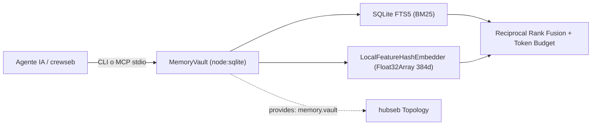

# memoseb

Una bóveda de **memoria híbrida multi-proyecto** (vectorial `Float32Array` + léxica `SQLite FTS5` con **Reciprocal Rank Fusion** y **presupuesto estricto de tokens**) para agentes de IA (**Antigravity CLI (`agy`)**, **Claude Code**, **Codex** y **OpenCode**).

Se conecta y registra automáticamente en [**hubseb**](../hubseb) y potencia la memoria persistente de [**crewseb**](../crewseb) mediante la capacidad `provides: ['memory.vault']`.

## Cómo funciona

- **Aislamiento Multi-Proyecto + Memoria Global**: Detecta automáticamente el proyecto activo inspeccionando la raíz de `package.json` o `.git` (o recibe `--project <id>`). Permite aislar el conocimiento de cada repositorio mientras comparte convenciones transversales en el proyecto `global`.
- **Tokenización y Vectorización Local Zero-Dependency**: Construido íntegramente sobre `node:sqlite` (Node.js `>=22`) en modo WAL. Incluye `LocalFeatureHashEmbedder` (`local-feature-hash-v1`), un motor determinista de *feature hashing* con `FNV-1a` que proyecta palabras, prefijos, bigramas y trigramas de caracteres en vectores `Float32Array` normalizados (384 dimensiones) sin depender de APIs externas ni binarios nativos adicionales.
- **Búsqueda Híbrida RRF + Presupuesto de Tokens**: Combina similitud coseno densa (`memory_vectors`) y ranking léxico `BM25` (`SQLite FTS5`) mediante **Reciprocal Rank Fusion (RRF)** ponderada por importancia (`0.0` a `1.0`). Trunca automáticamente los resultados para respetar `--max-tokens` (por defecto `1200` tokens) sin saturar la ventana de contexto del agente.
- **Servidor MCP `stdio` + CLI `hubseb/v1`**: Expone un servidor JSON-RPC 2.0 sobre `stdio` (`memoseb mcp`) y una interfaz CLI compatible con el contrato `hubseb/v1` (`--json`), emitiendo señales en tiempo real (`memory.stored`, `memory.forgotten`, `memoseb.deployed`) a la topología de `hubseb`.



## Instalación (Para Humanos o Agentes de IA)

```sh
npm install
npm run build
memoseb setup
```

`memoseb setup` registra el nodo `memoseb` en la topología de `hubseb` (`~/.config/seb/topology.json`), despliega la skill `/memoseb` e inyecta las directivas globales (`rules/RULES.md`) verificadas con SHA-256 en los agentes detectados (`--agents claude,antigravity` elige cuáles, `--agents all` fuerza los 4).

## Comandos CLI

Todos los comandos aceptan `--json` para responder bajo el sobre estándar `hubseb/v1` y `--db <path>` (o la variable de entorno `MEMOSEB_DB_PATH`) para especificar la ruta de la base de datos SQLite.

```sh
memoseb setup [--agents a,b|all]             # Registra en hubseb e instala directivas/skills en los agentes
memoseb remember "<texto>" [opciones]        # Guarda o actualiza una memoria (alias: store)
memoseb recall "<consulta>" [opciones]       # Búsqueda híbrida BM25 + Vector + RRF (alias: search)
memoseb context [--max-tokens N]             # Briefing del proyecto activo dentro del presupuesto (alias: briefing)
memoseb projects [--json]                    # Lista los proyectos indexados, conteo de memorias y tokens
memoseb forget <id> [--json]                 # Elimina una memoria obsoleta por su ID
memoseb stats [--json]                       # Muestra métricas globales de la bóveda (proyectos, vectores, tokens)
memoseb mcp                                  # Inicia el servidor MCP JSON-RPC 2.0 por stdio
memoseb check [--json]                       # Verifica la integridad SHA-256 de las directivas en cada host
memoseb uninstall [--json]                   # Purga archivos desplegados y desconecta el nodo de hubseb
memoseb capabilities [--json]                # Muestra capacidades (provides/consumes/signals) para hubseb
```

### Opciones de `remember` y `recall`

| Flag | Comandos | Descripción |
|---|---|---|
| `--category <cat>` | `remember`, `recall` | Categoría: `architecture`, `convention`, `bugfix`, `decision`, `domain` (por defecto `domain`) |
| `--title "<título>"` | `remember` | Título resumen (si se omite, se deriva de la primera línea) |
| `--tags <a,b,c>` | `remember`, `recall` | Etiquetas separadas por comas para filtrado y indexación FTS5 |
| `--importance <0..1>` | `remember` | Peso de relevancia entre `0.0` y `1.0` (por defecto `0.5`) |
| `--project <id>` | `remember`, `recall`, `context` | Sobrescribe el identificador del proyecto (usa `global` para memorias compartidas) |
| `--agent <id>` | `remember` | Identificador del agente o especialista de `crewseb` que origina el recuerdo |
| `--limit <N>` | `recall` | Número máximo de memorias a retornar (por defecto `5`) |
| `--max-tokens <N>` | `recall`, `context` | Presupuesto estricto de tokens para la respuesta (por defecto `1200`) |

## Servidor MCP (`memoseb mcp`)

`memoseb` incluye un servidor **Model Context Protocol (MCP)** nativo (`2024-11-05`) sobre `stdio`. Añádelo a la configuración MCP de tu cliente (Claude Code, Antigravity, Cursor, OpenCode, etc.):

```json
{
  "mcpServers": {
    "memoseb": {
      "command": "memoseb",
      "args": ["mcp"]
    }
  }
}
```

### Herramientas MCP Expuestas

| Herramienta | Parámetros principales | Qué hace |
|---|---|---|
| `memory_store` | `content` (req), `title`, `category`, `tags`, `projectId`, `sourceAgent`, `importance` | Guarda o deduplica por hash SHA-256 un aprendizaje de alto valor en la bóveda |
| `memory_recall` | `query` (req), `projectId`, `category`, `limit`, `maxTokens` | Ejecuta búsqueda híbrida FTS5 + coseno vectorial con fusión RRF y presupuesto de tokens |
| `memory_briefing` | `projectId`, `maxTokens` | Recupera el briefing prioritario del proyecto (`architecture`, `convention`, `decision`, `bugfix`) al iniciar sesión |
| `memory_forget` | `id` (req) | Elimina un registro de memoria obsoleto junto con su índice FTS5 y su vector |
