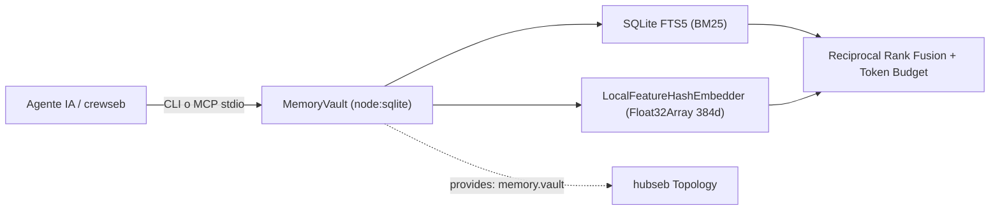
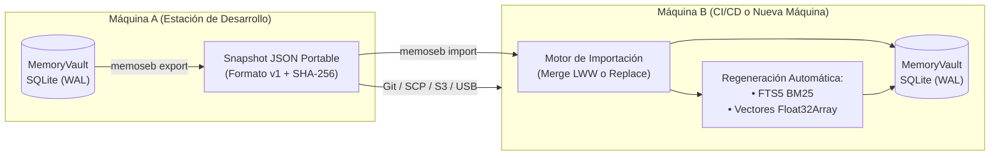
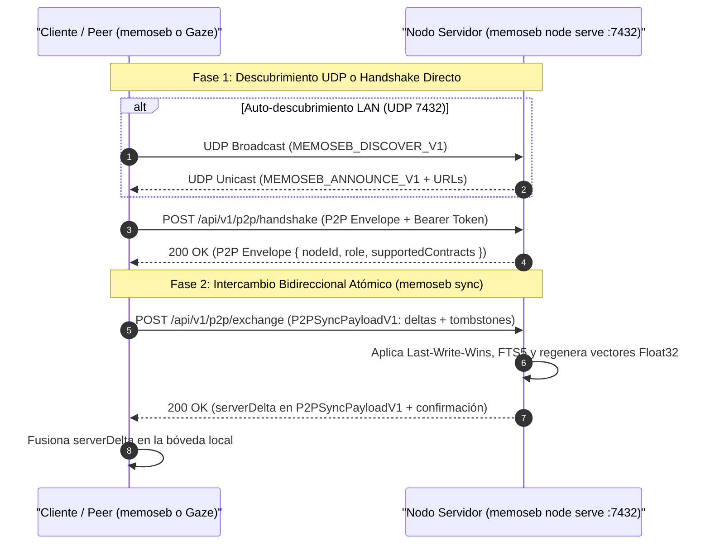

# memoseb

Una bóveda de **memoria híbrida multi-proyecto** (vectorial `Float32Array` + léxica `SQLite FTS5` con **Reciprocal Rank Fusion** y **presupuesto estricto de tokens**) para agentes de IA (**Antigravity CLI (`agy`)**, **Claude Code**, **Codex** y **OpenCode**).

Se conecta y registra automáticamente en [**hubseb**](https://github.com/PahesebPJ/hubseb) y potencia la memoria persistente de [**crewseb**](https://github.com/PahesebPJ/crewseb) mediante la capacidad `provides: ['memory.vault']`.

## Cómo funciona

- **Aislamiento Multi-Proyecto + Memoria Global**: Detecta automáticamente el proyecto activo inspeccionando la raíz de `package.json` o `.git` (o recibe `--project <id>`). Permite aislar el conocimiento de cada repositorio mientras comparte convenciones transversales en el proyecto `global`.
- **Análisis e Indexación Automática de Repositorios (`memoseb analyze`)**: Inspecciona manifiestos (`package.json`, `tsconfig.json`, `Cargo.toml`, `pyproject.toml`, `go.mod`, `Dockerfile`), estructura de directorios (`src/`), scripts, workflows CI y `README.md` para sintetizar y persistir automáticamente los 3 pilares base del proyecto (`architecture`, `convention` y `domain`).
- **Tokenización y Vectorización Local Zero-Dependency**: Construido íntegramente sobre `node:sqlite` (Node.js `>=22`) en modo WAL. Incluye `LocalFeatureHashEmbedder` (`local-feature-hash-v1`), un motor determinista de *feature hashing* con `FNV-1a` que proyecta palabras, prefijos, bigramas y trigramas de caracteres en vectores `Float32Array` normalizados (384 dimensiones) sin depender de APIs externas ni binarios nativos adicionales.
- **Búsqueda Híbrida RRF + Presupuesto de Tokens**: Combina similitud coseno densa (`memory_vectors`) y ranking léxico `BM25` (`SQLite FTS5`) mediante **Reciprocal Rank Fusion (RRF)** ponderada por importancia (`0.0` a `1.0`). Trunca automáticamente los resultados para respetar `--max-tokens` (por defecto `1200` tokens) sin saturar la ventana de contexto del agente.
- **Servidor MCP `stdio` + CLI `hubseb/v1`**: Expone un servidor JSON-RPC 2.0 sobre `stdio` (`memoseb mcp`) y una interfaz CLI compatible con el contrato `hubseb/v1` (`--json`), emitiendo señales en tiempo real (`memory.stored`, `memory.forgotten`, `memoseb.deployed`) a la topología de `hubseb`.



## Instalación (Para Humanos o Agentes de IA)

### Vía npm (Recomendado)

```sh
npm install -g memoseb
memoseb setup
```

### Desde código fuente (Desarrollo local)

```sh
git clone https://github.com/PahesebPJ/memoseb.git
cd memoseb
npm install
npm run build
memoseb setup
```

`memoseb setup` registra el nodo `memoseb` en la topología de `hubseb` (`~/.config/hubseb/topology.json`), despliega la skill `/memoseb` e inyecta las directivas globales (`rules/RULES.md`) verificadas con SHA-256 en los agentes detectados (`--agents claude,antigravity` elige cuáles, `--agents all` fuerza los 4).

## Comandos CLI

Todos los comandos aceptan `--json` para responder bajo el sobre estándar `hubseb/v1` y `--db <path>` (o la variable de entorno `MEMOSEB_DB_PATH`) para especificar la ruta de la base de datos SQLite.

```sh
memoseb setup [--agents a,b|all]             # Registra en hubseb e instala directivas/skills en los agentes
memoseb analyze [path] [--dry-run] [--json]  # Analiza un repositorio y guarda memorias de arquitectura, convenciones y dominio (alias: index, scan)
memoseb remember "<texto>" [opciones]        # Guarda o actualiza una memoria (alias: store)
memoseb recall "<consulta>" [opciones]       # Búsqueda híbrida BM25 + Vector + RRF (alias: search)
memoseb context [--max-tokens N]             # Briefing del proyecto activo dentro del presupuesto (alias: briefing)
memoseb projects [--json]                    # Lista los proyectos indexados, conteo de memorias y tokens
memoseb forget <id> [--json]                 # Elimina una memoria obsoleta por su ID
memoseb stats [--json]                       # Muestra métricas globales de la bóveda (proyectos, vectores, tokens)
memoseb export [file] [--format memoseb|gaze|p2p] [--project <id>] # Exporta a snapshot nativo o bundle P2P/Gaze con checksum SHA-256
memoseb import <file> [--replace] [--project <id>] # Importa snapshot nativo o bundle Gaze/P2P con merge LWW o --replace
memoseb node status | enable | disable | discover | set-parent | add-child | add-peer | remove | serve | service # Red Jerárquica (Padre/Hijo) o P2P Descentralizada
memoseb group create | list | add-node | remove-node | delete | default-policy # Control de acceso y grupos de permisos (ACL)
memoseb sync [--url <peer>] [--project <id>] [--full] [--format memoseb|gaze|p2p] # Sincronización bidireccional (Jerárquica o P2P Gaze)
memoseb mcp                                  # Inicia el servidor MCP JSON-RPC 2.0 por stdio
memoseb check [--json]                       # Verifica la integridad SHA-256 de las directivas en cada host
memoseb uninstall [--json]                   # Purga archivos desplegados, desconecta el nodo de hubseb y quita el servicio de nodo si está instalado
memoseb capabilities [--json]                # Muestra capacidades (provides/consumes/signals) para hubseb
```

### Opciones de Comandos Principales

| Flag | Comandos | Descripción |
|---|---|---|
| `--dry-run` | `analyze` | Sintetiza los borradores de memoria del repositorio sin persistirlos en SQLite |
| `--category <cat>` | `remember`, `recall` | Categoría: `architecture`, `convention`, `bugfix`, `decision`, `domain` (por defecto `domain`) |
| `--title "<título>"` | `remember` | Título resumen (si se omite, se deriva de la primera línea) |
| `--tags <a,b,c>` | `remember`, `recall` | Etiquetas separadas por comas para filtrado y indexación FTS5 |
| `--importance <0..1>` | `remember` | Peso de relevancia entre `0.0` y `1.0` (por defecto `0.5`) |
| `--project <id>` | `analyze`, `remember`, `recall`, `context`, `export`, `import`, `sync` | Sobrescribe el identificador del proyecto (usa `global` para memorias compartidas) |
| `--agent <id>` | `analyze`, `remember` | Identificador del agente o especialista de `crewseb` que origina el recuerdo |
| `--limit <N>` | `recall` | Número máximo de memorias a retornar (por defecto `5`) |
| `--max-tokens <N>` | `recall`, `context` | Presupuesto estricto de tokens para la respuesta (por defecto `1200`) |
| `--replace` | `import` | Reemplaza todas las memorias del proyecto en lugar de fusionar por Last-Write-Wins |
| `--strategy <s>` | `import` | Estrategia de importación: `merge` (por defecto) o `replace` |
| `--format <f>` | `export`, `import`, `sync` | Formato de contrato o bundle: `memoseb` (por defecto) o `gaze`/`p2p` (contrato interoperable P2P) |
| `--contract <c>` | `sync` | Alias de `--format`: `memoseb` o `gaze`/`p2p` |
| `--role <r>` | `node enable`, `node serve` | Rol del nodo en la red: `parent`, `child`, o `peer`/`p2p` (par simétrico) |
| `--port <N>` | `node enable`, `node serve`, `node discover` | Puerto HTTP/UDP para el servicio de red (por defecto `7432`) |
| `--token <sec>` | `node enable`, `node set-parent`, `node add-child`, `node add-peer`, `group create`, `sync` | Secreto/token Bearer para autenticación segura entre nodos o token dedicado de grupo |
| `--parent <url>` | `node enable` | URL directa del nodo Padre al habilitar un nodo Hijo |
| `--peer <url>` | `node enable` | URL directa del nodo Par al habilitar un nodo en modo `peer`/`p2p` |
| `--discover` | `node enable` | Auto-descubre nodos en la red LAN local mediante sondeo UDP `:7432` |
| `--url <peer>` | `sync`, `node set-parent`, `node add-child`, `node add-peer`, `node remove` | URL del peer remoto (ej. `http://192.168.1.50:7432`) |
| `--full` | `sync` | Fuerza una sincronización completa de snapshot en lugar de sincronización delta |
| `--purge-peers` | `node disable` | Elimina los peers registrados al desactivar la red del nodo |
| `--projects <p1,p2>` | `group create` | Proyectos autorizados para el grupo (separados por comas o `*` para todos) |
| `--categories <c1,c2>` | `group create` | Categorías autorizadas para el grupo (`architecture`, `convention`, `bugfix`, `decision`, `domain`, o `*`) |
| `--permissions <m>` | `group create` | Modo de acceso del grupo: `readwrite` (por defecto), `readonly` o `writeonly` |
| `--policy <p>` | `group default-policy` | Política para nodos sin grupo asignado: `none` (denegar) o `all` (permitir todo) |
| `--group <name>` | `node add-child`, `node set-parent`, `node enable` | Asigna o solicita vinculación al grupo de permisos especificado |

## Portabilidad entre Máquinas (`export` / `import`)

`memoseb` permite exportar e importar el estado completo de la memoria o el contexto de un proyecto específico mediante snapshots JSON autocontenidos y canónicos.

### Características del Snapshot
- **Integridad Criptográfica**: Cada snapshot incluye un checksum `SHA-256` canónico calculado sobre su contenido ordenado. Si el archivo es alterado o truncado, el proceso de importación lo detecta y lo rechaza de inmediato.
- **Tombstones de Eliminación**: Incluye registros de eliminación (`tombstones`) para propagar de forma segura recuerdos borrados sin riesgo de resurrección accidental.
- **Soporte Dual de Formatos (Nativo y Gaze P2P)**: Exporta tanto al snapshot nativo (`memoseb-snapshot`) como a bundles interoperables `p2p-memory-contract` mediante `--format gaze` o `--format p2p`. Al importar, `memoseb` autodetecta el formato (desenvolviendo sobres `P2PContractEnvelopeV1` si existen) y ejecuta un mapeo lossless automático.
- **Estrategias de Importación**:
  - `merge` (predeterminada): Resuelve conflictos mediante **Last-Write-Wins (LWW)** basándose en marcas de tiempo ISO-8601 (`updatedAt`) y hashes de contenido. Si un recuerdo local es más reciente, se preserva; si el remoto es más nuevo o inexistente, se inserta o actualiza.
  - `--replace`: Limpia las memorias previas del proyecto y restaura el snapshot como única fuente de verdad.
- **Regeneración Zero-Dependency de Vectores y FTS5**: Al importar en cualquier máquina, `memoseb` reconstruye automáticamente el índice léxico `SQLite FTS5` (BM25) y regenera todos los vectores `Float32Array` de 384 dimensiones mediante `local-feature-hash-v1` de forma transparente y determinista, sin requerir APIs externas ni bases de datos vectoriales pesadas.



### Ejemplos Prácticos

```bash
# 1. Exportar toda la bóveda al archivo predeterminado (memoseb-snapshot.json)
memoseb export

# 2. Exportar un único proyecto a una ruta personalizada
memoseb export ./backups/memoseb-auth-service.json --project auth-service

# 3. Importar fusionando mediante Last-Write-Wins (merge)
memoseb import ./backups/memoseb-auth-service.json

# 4. Importar reemplazando por completo las memorias de un proyecto específico
memoseb import ./backups/memoseb-auth-service.json --replace --project auth-service

# 5. Exportar bundle P2P compatible con KikeDeAlba/gaze (p2p-memory-contract v1)
memoseb export ./backups/gaze-bundle.json --format gaze --project auth-service

# 6. Importar bundle de Gaze o snapshot nativo (autodetectado con merge LWW)
memoseb import ./backups/gaze-bundle.json
```

## Sincronización en Red: Jerárquica (Padre ↔ Hijos) y P2P Descentralizada (`peer`/`p2p` ↔ Gaze)

Por diseño y seguridad, `memoseb` opera por defecto en **modo standalone** (red desactivada, operación 100% local y offline).

Cuando trabajas en equipo, con múltiples estaciones de trabajo, entornos de prueba o flotas de agentes coordinados por `crewseb`, `memoseb` ofrece **coexistencia dual de sincronización** sobre una misma bóveda SQLite:

1. **Topología Jerárquica (`parent` ↔ `child`)**: Un nodo central (`parent`) consolida el conocimiento emitido por múltiples nodos subordinados (`child`) en una topología en estrella (Hub-and-Spoke).
2. **Topología P2P Descentralizada (`peer` / `p2p`) e Interoperabilidad con `KikeDeAlba/gaze`**: Pares equivalentes y federados (Mesh) donde cualquier nodo puede sincronizar bidireccionalmente con otros nodos `memoseb` o agentes de grafo de memoria [`KikeDeAlba/gaze`](https://github.com/KikeDeAlba/gaze) mediante el contrato canónico [`docs/GAZE_P2P_CONTRACT.md`](docs/GAZE_P2P_CONTRACT.md).

### Arquitectura de Red y Protocolo P2P

- **Descubrimiento UDP LAN (`:7432`)**: Paquetes `MEMOSEB_DISCOVER_V1` y `MEMOSEB_ANNOUNCE_V1` con autenticación opcional HMAC-SHA256 (`authTag`).
- **Endpoints REST Canónicos y Fallback Automático**: Rutas P2P dedicadas (`/api/v1/p2p/status`, `/api/v1/p2p/handshake`, `/api/v1/p2p/exchange`) que encapsulan la carga en sobres estándar `P2PContractEnvelopeV1` (compatibles con `KikeDeAlba/kit`), con fallback transparente a `/api/v1/sync/*`.
- **Cabeceras de Autenticación Flexibles**: Valida indistintamente `Authorization: Bearer <token>`, `X-Memoseb-Token: <token>` o `X-Gaze-Token: <token>` con comparación en tiempo constante.
- **Resolución Determinista**: Ambos modos resuelven conflictos mediante **Last-Write-Wins (LWW)** basándose en marcas de tiempo ISO-8601 (`updatedAt`) y hash SHA-256 (`contentHash`), propagando `tombstones` criptográficos para borrados definitivos.
- **Mapeo Bidireccional Lossless**: Traduce automáticamente y sin pérdida entre `MemoryRecord` (`convention`, `decision`, `architecture`, `bugfix`, `domain`) y `GazeNodeV1` (`rule`, `decision`, `fact`, `memory`, `doc`, `issue`), preservando aristas (`edges`), atributos métricos y fidelidad contextual. Consulta la especificación exhaustiva en [`docs/GAZE_P2P_CONTRACT.md`](docs/GAZE_P2P_CONTRACT.md).

- **Nodo Padre (`parent`)**: Concentrador central en topología jerárquica.
- **Nodos Hijos (`child`)**: Clientes subordinados que sincronizan exclusivamente con su nodo Padre.
- **Nodos Pares (`peer` / `p2p`)**: Nodos simétricos en topología de malla que sincronizan directamente entre sí o con agentes `KikeDeAlba/gaze`.



### Guía Paso a Paso

#### Modo A: Configuración P2P Descentralizada (o Conexión con KikeDeAlba/gaze)

```bash
# 1. Habilitar el nodo en rol P2P (p2p es alias directo de peer)
memoseb node enable --role p2p --port 7432 --token "mi-token-secreto"

# 2. Iniciar el servicio HTTP con auto-sync (o, opcional, como servicio: memoseb node service install)
memoseb node serve

# 3. Emparejar con un nodo peer de memoseb o un agente KikeDeAlba/gaze (o dejar que Tailscale lo descubra)
memoseb node add-peer http://192.168.1.180:7432 --name "gaze-peer" --token "mi-token-secreto"

# 4. Sincronizar bidireccionalmente usando el contrato Gaze P2P
memoseb sync --format gaze

# 5. O sincronizar todos los peers registrados
memoseb sync
```

#### Auto-sync, descubrimiento por Tailscale y servicio opcional

- **`memoseb node serve` sincroniza solo**: al arrancar, cada `--interval` minutos (por omisión 5, se guarda con `node enable --interval N`), tras escrituras de otros procesos (CLI, MCP) detectadas con `PRAGMA data_version`, tras importaciones remotas que aplicaron cambios y en cuanto descubre un peer nuevo. `--no-auto-sync` lo desactiva. Fuera de `serve`, `remember` y `forget` siguen disparando el auto-sync de siempre.
- **Descubrimiento unicast por Tailscale**: además del broadcast UDP de la LAN, `serve` y `node discover` leen `tailscale status --json` (binario de `--tailscale-bin`, `MEMOSEB_TAILSCALE_BIN`, `PATH`, `/opt/homebrew/bin`, `/usr/local/bin`, `/Applications/Tailscale.app/Contents/MacOS/Tailscale`; en Windows `tailscale.exe` en el `PATH` y `C:\Program Files\Tailscale\tailscale.exe`), sondean `GET /api/v1/p2p/status` de cada peer en línea con el token y registran los válidos. Sin Tailscale o con un estado distinto de `Running` no hace nada. `--no-tailscale` lo apaga.
- **`callbackUrl`**: cada intercambio manda la URL por la que el otro nodo puede devolvernos la llamada (IP de Tailscale preferida, loopback si el peer es local), así el servidor nos registra solo.
- **Token obligatorio en `peer`**: `node enable --role peer|p2p` sin token genera uno (64 hex) y lo muestra una sola vez; usa el mismo en todos los nodos. `node serve` se niega a servir un nodo `peer` fuera de loopback sin token y el servidor responde `401 TOKEN_REQUIRED`. Los roles `parent`/`child` no cambian.
- **El servicio en segundo plano es opcional y explícito**: `node enable` **no** instala servicios, tareas programadas, entradas de Startup ni reglas de firewall. Para dejar `serve` corriendo al iniciar sesión:

```bash
memoseb node service install     # launchd (macOS), systemd --user (Linux) o tarea al iniciar sesión (Windows), sin elevación
memoseb node service status
memoseb node service uninstall   # también lo quitan `memoseb node disable` y `memoseb uninstall`
```

En Windows la tarea `memoseb-node` corre `memoseb node serve --detach`; si `schtasks` no se deja crear, usa la carpeta Startup del perfil. Para aceptar peers por Tailscale hay que permitir el puerto en el Firewall de Windows (opt-in):

```powershell
# Imprime el comando; --apply lo ejecuta pidiendo elevación (UAC)
memoseb node service firewall [--apply]
New-NetFirewallRule -DisplayName memoseb-node -Direction Inbound -Action Allow -Protocol TCP -LocalPort 7432 -RemoteAddress 100.64.0.0/10 -Profile Any
```

#### Modo B: Configuración Jerárquica (Padre ↔ Hijos)

##### 1. Configurar y Levantar el Nodo Padre

En la máquina central o servidor:

```bash
# Habilitar el rol parent especificando el puerto y un secreto de autenticación
memoseb node enable --role parent --port 7432 --token "mi-token-secreto-compartido"

# Iniciar el servicio HTTP y respondedor UDP en primer plano (o como daemon)
memoseb node serve
```

> [!NOTE]
> `memoseb node serve` escucha en `0.0.0.0:7432` por defecto y responde a sondeos de descubrimiento UDP en la LAN. Si deseas limitar el servicio solo a HTTP sin descubrimiento UDP, añade `--no-lan`.

##### 2. Configurar el Nodo Hijo

En la laptop, máquina de desarrollo o agente de IA:

**Opción A: Auto-descubrimiento en la misma red LAN**
Si ambas máquinas están en la misma red local o WiFi:
```bash
memoseb node enable --role child --discover --token "mi-token-secreto-compartido"
```
`memoseb` emitirá un broadcast UDP, encontrará al Padre, validará el handshake y configurará la URL del peer automáticamente.

**Opción B: Conexión por IP / URL directa**
Si el Padre está en otra subred, contenedor Docker, VPS o red remota:
```bash
memoseb node enable --role child --parent http://192.168.1.50:7432 --token "mi-token-secreto-compartido"
```

##### 3. Ejecutar la Sincronización

```bash
# Sincronización bidireccional de deltas con los peers configurados
memoseb sync

# Sincronizar únicamente un proyecto en particular
memoseb sync --project mi-proyecto

# Sincronizar directamente contra una URL específica sin haberla guardado
memoseb sync --url http://192.168.1.50:7432 --token "mi-token-secreto-compartido"

# Forzar sincronización completa de snapshot (en lugar de solo deltas)
memoseb sync --full
```

> [!TIP]
> Si el nodo se configuró con auto-sincronización (`--auto-sync`, habilitado por defecto al hacer `node enable`), cualquier memoria guardada (`remember`), borrada (`forget`) o indexada (`analyze`) disparará automáticamente un ciclo de sincronización en segundo plano con el nodo Padre.

#### Diagnóstico y Desconexión del Nodo

```bash
# Ver estado del nodo, rol, auto-sync, URLs LAN e historial de sincronización de peers
memoseb node status

# Buscar manualmente padres activos en la red LAN sin conectarse
memoseb node discover

# Cambiar la URL del nodo Padre
memoseb node set-parent http://192.168.1.50:7432 --token "mi-token-secreto-compartido"

# Registrar manualmente un nodo Hijo en el Padre
memoseb node add-child http://192.168.1.100:7432 --name "laptop-agente"

# Desvincular un peer por URL o identificador
memoseb node remove http://192.168.1.100:7432
```

```bash
# Desactivar el networking volviendo al modo standalone manteniendo los peers
memoseb node disable

# Desactivar el networking y purgar los peers registrados
memoseb node disable --purge-peers
```

### Control de Acceso y Grupos de Permisos (`memoseb group`)

Cuando múltiples agentes, equipos o nodos hijos se sincronizan con un nodo Padre central, `memoseb` permite segmentar y gobernar el acceso mediante **Listas de Control de Acceso (ACL)** y **Grupos de Permisos**.

#### Principios de Operación
- **Sin grupos configurados**: La sincronización es irrestricta (`unrestricted`). Cualquier peer autenticado con el token del nodo tiene acceso completo de lectura y escritura a todos los proyectos y categorías.
- **Con grupos activos**: En cuanto se crea al menos un grupo, se activa el control de acceso granular. Los nodos sincronizan únicamente los proyectos y categorías autorizados en sus grupos.
- **Política para nodos no asignados (`default-policy`)**: Define el comportamiento ante nodos autenticados que no pertenecen a ningún grupo:
  - `none` (predeterminada): Bloquea push y pull para nodos sin grupo asignado.
  - `all`: Concede acceso irrestricto de lectura y escritura a los nodos sin grupo.
- **Modos de Permiso**:
  - `readwrite` (predeterminado): El nodo puede enviar (`push`) y recibir (`pull`) memorias dentro de los proyectos y categorías autorizados.
  - `readonly`: El nodo solo puede recibir (`pull`) memorias autorizadas del Padre; los intentos de `push` son rechazados.
  - `writeonly`: El nodo solo puede emitir (`push`) memorias hacia el Padre; no recibe deltas en `pull`.

#### Ejemplos Prácticos de Configuración

##### 1. Crear un Grupo Restringido a un Proyecto Específico
```bash
# Crear grupo con acceso de lectura y escritura solo al proyecto "proyecto-x" y token dedicado
memoseb group create grupo-x --projects proyecto-x --permissions readwrite --token "token-grupo-x"
```

##### 2. Restringir por Categorías y Modo Solo Lectura
```bash
# Permitir únicamente lectura de convenciones y arquitectura del proyecto "core-api"
memoseb group create equipo-analisis --projects core-api --categories architecture,domain --permissions readonly
```

##### 3. Asignación de Nodos Hijos a Grupos

Los nodos hijos pueden asignarse a uno o más grupos de forma manual o automática:

- **Asignación manual vía CLI**:
  ```bash
  # Asignar un nodo por URL, Node ID o nombre
  memoseb group add-node grupo-x http://192.168.1.100:7432

  # Desasignar el nodo del grupo
  memoseb group remove-node grupo-x http://192.168.1.100:7432
  ```

- **Al registrar un hijo en el Padre**:
  ```bash
  # Registra el peer y lo asocia automáticamente al grupo
  memoseb node add-child http://192.168.1.100:7432 --group grupo-x
  ```

- **Automática por Token dedicado o Handshake**:
  - **Por token dedicado**: Si el grupo fue creado con `--token token-grupo-x`, cualquier hijo que se configure usando ese token (`memoseb node enable --role child --token token-grupo-x`) es asignado automáticamente al grupo al autenticarse.
  - **Por flag `--group` en el hijo**: Si el hijo especifica `--group grupo-x` al conectarse (`memoseb node enable --role child --group grupo-x --token <secreto>`), el nodo Padre asocia el nodo al grupo durante el handshake.

##### 4. Política por Defecto para Nodos sin Grupo
```bash
# Denegar sincronización a cualquier nodo no registrado explícitamente en un grupo (recomendado)
memoseb group default-policy none

# O permitir sincronización irrestricta a nodos no asignados
memoseb group default-policy all
```

##### 5. Listar y Eliminar Grupos
```bash
# Listar todos los grupos configurados, miembros y política activa
memoseb group list

# Eliminar un grupo
memoseb group delete grupo-x
```

## Servidor MCP (`memoseb mcp`)

`memoseb` incluye un servidor **Model Context Protocol (MCP)** nativo (`2024-11-05`) sobre `stdio`. Añádelo a la configuración MCP de tu cliente (Claude Code, Antigravity, Cursor, OpenCode, etc.):

```json
{
  "mcpServers": {
    "memoseb": {
      "command": "memoseb",
      "args": ["mcp"]
    }
  }
}
```

### Herramientas MCP Expuestas

| Herramienta | Parámetros principales | Qué hace |
|---|---|---|
| `memory_store` | `content` (req), `title`, `category`, `tags`, `projectId`, `sourceAgent`, `importance` | Guarda o deduplica por hash SHA-256 un aprendizaje de alto valor en la bóveda |
| `memory_recall` | `query` (req), `projectId`, `category`, `limit`, `maxTokens` | Ejecuta búsqueda híbrida FTS5 + coseno vectorial con fusión RRF y presupuesto de tokens |
| `memory_briefing` | `projectId`, `maxTokens` | Recupera el briefing prioritario del proyecto (`architecture`, `convention`, `decision`, `bugfix`) al iniciar sesión |
| `memory_forget` | `id` (req) | Elimina un registro de memoria obsoleto junto con su índice FTS5 y su vector |
| `memory_analyze` | `path`, `projectId`, `dryRun` | Analiza un repositorio y sintetiza memorias de `architecture`, `convention` y `domain` en la bóveda |
| `memory_export` | `filePath`, `projectId`, `format` | Exporta la bóveda completa o un proyecto a snapshot JSON (`memoseb`) o bundle P2P/Gaze (`gaze` / `p2p`) con checksum SHA-256 |
| `memory_import` | `filePath` (req), `strategy`, `projectId`, `format` | Importa snapshot JSON nativo o bundle Gaze/P2P autodetectado con resolución Last-Write-Wins (o `--replace`), reindexando FTS5 y vectores |
| `memory_sync` | `peerUrl`, `projectId`, `full`, `format` | Ejecuta sincronización bidireccional (jerárquica o P2P Gaze mediante `format: 'gaze'`) de deltas y tombstones |
| `memory_group` | `action` (req: `list`, `create`, `add_node`, `remove_node`, `delete`, `default_policy`), `name`, `projects`, `categories`, `permissions`, `groupToken`, `description`, `node`, `policy` | Administra grupos de permisos y reglas ACL de sincronización por proyecto, categoría y modo de acceso |
