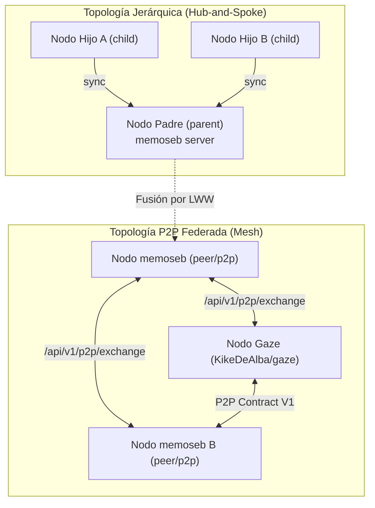
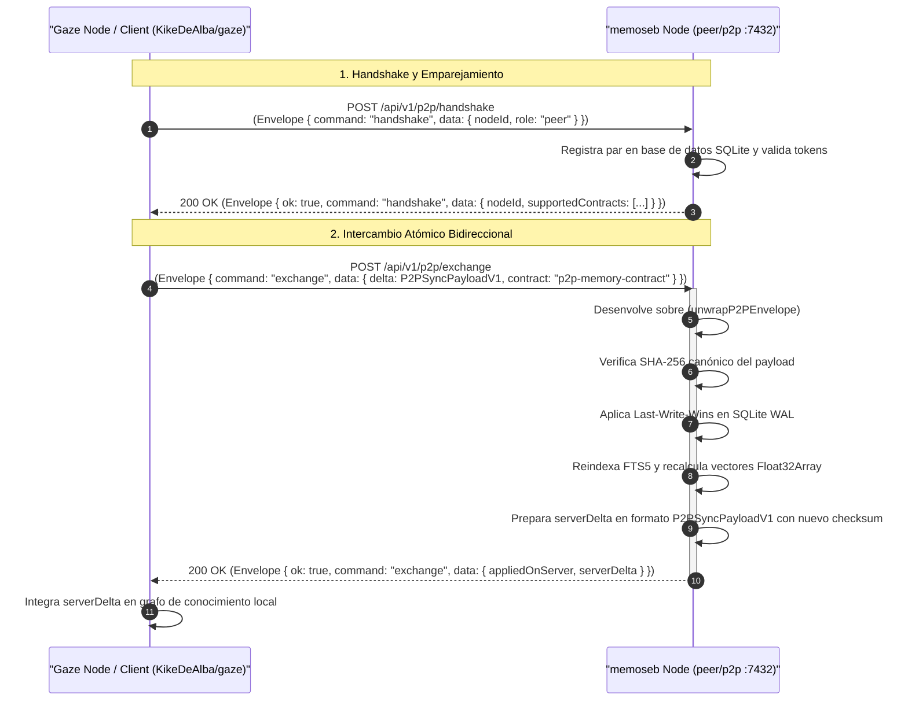

# Contrato Técnico Oficial de Interoperabilidad P2P: `memoseb` ↔ `KikeDeAlba/gaze`

Este documento define la especificación técnica completa, el modelo de datos bidireccional y los contratos de red para la interoperabilidad descentralizada punto a punto (P2P) entre la bóveda de memoria [**`memoseb`**](https://github.com/PahesebPJ/memoseb) y el grafo de memoria [**`KikeDeAlba/gaze`**](https://github.com/KikeDeAlba/gaze), en plena compatibilidad con los estándares de sobre de [`KikeDeAlba/kit`](https://github.com/KikeDeAlba/kit).

---

## 1. Arquitectura de Coexistencia Dual en `memoseb`

`memoseb` soporta dos modelos operacionales de sincronización sobre una misma base de persistencia SQLite (WAL + FTS5 + vectores `Float32Array`):

1. **Modo Jerárquico (`parent` / `child`)**:
   - Orientado a topologías en estrella (Hub-and-Spoke).
   - Un nodo central (`parent`) consolida la memoria de múltiples nodos clientes (`child`), tales como estaciones de trabajo o agentes subordinados.
   - Ideal para control corporativo centralizado y flujos de consolidación vertical.
2. **Modo P2P Descentralizado (`peer` / `p2p`)**:
   - Orientado a topologías en malla (Mesh) y comunicación federada.
   - Todos los nodos son pares simétricos; cualquier nodo puede iniciar un intercambio bidireccional contra cualquier otro nodo `memoseb` o agente `gaze`.
   - `p2p` es un alias de primera clase para `peer`: la CLI y la API normalizan de forma transparente `--role p2p` hacia el rol de par (`NodeRole = 'peer'`).



Ambos modos comparten el motor unificado de resolución:
- **Last-Write-Wins (LWW)** determinista basado en marcas de tiempo ISO-8601 (`updatedAt`) y hash SHA-256 (`contentHash`).
- **Propagación de Tombstones**: Eliminaciones registradas criptográficamente para evitar resurrección accidental de datos.
- **Grupos de Permisos (ACL)**: Filtrado granular por proyecto, categoría y modo de acceso (`readwrite`, `readonly`, `writeonly`).

---

## 2. Especificación del Sobre: `P2PContractEnvelopeV1`

Para garantizar la interoperabilidad sin fricciones con `KikeDeAlba/kit` y los servicios del ecosistema `gaze`, las comunicaciones HTTP P2P y los archivos exportados pueden encapsularse en el sobre canónico `P2PContractEnvelopeV1`.

### Definición TypeScript

```typescript
export interface P2PContractEnvelopeV1<T = unknown> {
  schemaVersion: 1
  ok: boolean
  command: string
  generatedAt: string
  data: T
  error?: {
    code: string
    message: string
  }
}
```

### Campos del Sobre

| Campo | Tipo | Requerido | Descripción |
|---|---|---|---|
| `schemaVersion` | `1` (literal) | Sí | Versión del sobre de interoperabilidad. Debe ser `1`. |
| `ok` | `boolean` | Sí | `true` si la operación concluyó exitosamente; `false` en caso de error. |
| `command` | `string` | Sí | Nombre de la operación (`handshake`, `exchange`, `status`, `export`, etc.). |
| `generatedAt` | `string` (ISO-8601) | Sí | Marca de tiempo UTC en que se emitió el sobre. |
| `data` | `T` | Sí | Carga útil (payload) del comando ejecutado. |
| `error` | `{ code: string; message: string }` | Opcional | Detalle de fallo en caso de que `ok === false`. |

### Desenvolvimiento Transparente (`unwrapP2PEnvelope`)

El motor de `memoseb` implementa unwrapping automático: si un payload recibido contiene `schemaVersion: 1` y una propiedad `data`, extrae la información interna; si recibe directamente el objeto de datos, lo procesa sin requerir adaptación previa.

---

## 3. Especificación del Payload: `P2PSyncPayloadV1`

El payload transportado en los intercambios P2P (`/api/v1/p2p/exchange`) y en bundles exportados con formato `p2p` o `gaze` sigue el contrato `p2p-memory-contract` versión `1`.

### Definición TypeScript

```typescript
export const P2P_CONTRACT_FORMAT = 'p2p-memory-contract' as const
export const P2P_CONTRACT_VERSION = 1 as const

export interface P2PSyncPayloadV1 {
  format: 'p2p-memory-contract'
  version: 1
  app?: 'memoseb' | 'gaze'
  originNodeId: string
  originNodeName?: string
  exportedAt: string
  projectId?: string | null
  projectFilter?: string | null
  projects?: P2PProjectV1[]
  nodes: GazeNodeV1[]
  edges?: GazeEdgeV1[]
  tombstones: P2PTombstoneV1[]
  checksum: string
}

export interface P2PProjectV1 {
  id?: string
  slug?: string
  name: string
  rootPath?: string
  bitaId?: number | null
  key?: string | null
  updatedAt: string
}

export interface P2PTombstoneV1 {
  id?: string
  memoryId?: string
  project?: string
  projectId?: string
  contentHash: string
  deletedAt: string
  originNodeId: string | null
}
```

### Verificación de Integridad mediante Checksum Canónico

El campo `checksum` garantiza que ningún byte sea alterado durante la transferencia o el almacenamiento. Se calcula aplicando **SHA-256** sobre la representación JSON canónica (`canonicalStringify`, con claves ordenadas lexicográficamente) del objeto normalizado:

```typescript
const normalized = {
  format: payload.format,
  version: payload.version,
  originNodeId: payload.originNodeId,
  exportedAt: payload.exportedAt,
  projectId: payload.projectId ?? payload.projectFilter ?? null,
  nodes: payload.nodes,
  edges: payload.edges ?? [],
  tombstones: payload.tombstones
}
const checksum = crypto.createHash('sha256').update(canonicalStringify(normalized)).digest('hex')
```

---

## 4. Mapeo Bidireccional Lossless: `MemoryRecord` ↔ `GazeNodeV1`

Uno de los pilares del contrato es la conversión sin pérdida de información (lossless) entre los recuerdos de `memoseb` y los nodos del grafo de conocimiento de `gaze`.

### 4.1 Definición de Estructuras

#### `MemoryRecord` (`memoseb`)
```typescript
export interface MemoryRecord {
  id: string
  projectId: string
  category: 'architecture' | 'convention' | 'bugfix' | 'decision' | 'domain'
  title: string
  content: string
  tags: string[]
  sourceAgent: string | null
  contentHash: string
  tokenCount: number
  importance: number // 0.0 a 1.0
  accessCount: number
  createdAt: string
  updatedAt: string
}
```

#### `GazeNodeV1` (`gaze`)
```typescript
export interface GazeNodeV1 {
  id: string
  project?: string
  projectId?: string
  kind: 'rule' | 'fact' | 'decision' | 'doc' | 'entry' | 'issue' | 'meeting' | 'memory'
  source: 'claude' | 'harvest' | 'inkwell' | 'recap' | 'bita' | 'tally' | 'import' | 'user'
  sourceRef?: string | null
  title: string
  body: string
  pinned?: boolean
  until?: string | null
  createdAt: string
  updatedAt: string
  hits?: number
  contentHash?: string
  attrs?: Array<{ key: string; value: string }>
  edges?: GazeEdgeV1[]
  tags?: string[]
}
```

### 4.2 Tabla de Mapeo de Categorías y Tipos

| Categoría en `memoseb` | Kind en `Gaze` | Atributo `memoseb:category` | Nota |
|---|---|---|---|
| `convention` | `rule` | *(no requerido)* | Mapeo natural 1:1 con reglas de comportamiento. |
| `decision` | `decision` | *(no requerido)* | Mapeo natural 1:1 con acuerdos arquitectónicos. |
| `architecture` | `fact` | `architecture` | Se preserva la semántica exacta mediante atributo. |
| `domain` | `fact` | `domain` | Conceptos e invariantes de negocio. |
| `bugfix` | `memory` | `bugfix` | Fallos depurados y lecciones aprendidas. |

En sentido inverso (`GazeNodeV1` → `MemoryRecord`), si el nodo contiene el atributo `memoseb:category`, se utiliza ese valor directamente. En su defecto, se aplica la siguiente heurística de fallback:
- `rule` → `convention`
- `decision` / `meeting` → `decision`
- `issue` → `bugfix`
- `doc` → `architecture`
- `fact` / `memory` / `entry` → `domain`

### 4.3 Preservación de Metadatos y Grafo de Aristas

Para garantizar fidelidad completa entre ambos ecosistemas:

1. **Atributos Métricos de `memoseb` en `attrs` de `gaze`**:
   - `memoseb:token_count`: conteo exacto de tokens.
   - `memoseb:importance`: peso de relevancia flotante (`0.0` a `1.0`).
   - `memoseb:access_count`: frecuencia de acceso.
   - `memoseb:source_agent`: nombre del agente o rol de origen (si no coincide con los enumerados nativos de `GazeSource`).
   - Cada etiqueta de usuario (`userTag`) se almacena tanto en `tags` como en `attrs` con `{ key: "tag", value: "<etiqueta>" }`.

2. **Metadatos Nativos de `gaze` preservados en `tags` de `memoseb`**:
   - `gaze:kind:<kind>`
   - `gaze:source:<source>`
   - `gaze:source_ref:<ref>`
   - `gaze:until:<timestamp>`
   - `gaze:edge:<dst>:<kind>[:<weight>]` (o `gaze:edge:<src>-><dst>:<kind>[:<weight>]` cuando el `src` de la arista no es el propio nodo)
   - Las aristas de `edges[]` de nivel superior del payload se fusionan en las etiquetas del nodo `src` (`sourceId` o `src`) si ese nodo viaja en el mismo payload; si no, se ignoran. `edges: null` se acepta y cuenta como `[]` en el checksum.

4. **`contentHash`**:
   - Al importar, `memoseb` siempre usa `sha256("<projectId>:<category>:<content.trim()>")`, la misma fórmula de `storeMemory` y la que exporta gaze. Un `contentHash` ausente o calculado con otra fórmula se recalcula, para que el emparejamiento por `(project_id, content_hash)` funcione entre ambos.

3. **Relevancia e Importancia**:
   - `MemoryRecord.importance >= 0.85` ↔ `GazeNodeV1.pinned = true`.
   - Si un nodo Gaze tiene `pinned === true` y carece de `memoseb:importance`, se inicializa con `importance = 0.9`.
   - `MemoryRecord.accessCount` ↔ `GazeNodeV1.hits`.

---

## 5. Protocolo de Red P2P

### 5.1 Auto-Descubrimiento Local por UDP

El protocolo implementa descubrimiento local sin configuración previa sobre el puerto UDP `7432`:

- **Solicitud de Descubrimiento (`MEMOSEB_DISCOVER_V1`)**:
  - Broadcast a `255.255.255.255` y `127.0.0.1`.
  - Carga JSON:
    ```json
    {
      "magic": "MEMOSEB_DISCOVER_V1",
      "nonce": "c929a738-4f51-41fa-8d48-6a56ecbe319b",
      "timestamp": "2026-11-10T04:00:00.000Z",
      "authTag": "hex(HMAC-SHA256(token, 'udp|' + nonce + '|' + ipDestino + ':' + puertoUdp))"
    }
    ```
- Se envía un datagrama por destino, cada uno con el tag ligado a su `ip:puerto` de destino (por ejemplo `255.255.255.255:7432` o `127.0.0.1:7432`).
- Si el nodo tiene token (global o de grupo), **no responde** a solicitudes sin un `authTag` válido para alguno de sus destinos posibles (sus IPv4 locales, sus direcciones de broadcast, `255.255.255.255` y `127.0.0.1`).
- **Respuesta de Anuncio (`MEMOSEB_ANNOUNCE_V1`)**:
  - Unicast directo a la dirección y puerto de origen del datagrama.
  - Carga JSON:
    ```json
    {
      "magic": "MEMOSEB_ANNOUNCE_V1",
      "nonce": "c929a738-4f51-41fa-8d48-6a56ecbe319b",
      "nodeId": "node-memoseb-alpha-7f8a",
      "nodeName": "Workstation Astrid",
      "role": "peer",
      "port": 7432,
      "urls": ["http://192.168.1.150:7432"],
      "requiresAuth": true,
      "app": "memoseb",
      "contracts": ["memoseb-snapshot", "p2p-memory-contract"],
      "authTags": {
        "192.168.1.150": "hex(HMAC-SHA256(token, 'udp|response|' + nonce + '|' + 192.168.1.150 + ':' + puertoUdp))"
      }
    }
    ```
- `authTags` lleva un tag por cada IPv4 local desde la que puede salir el datagrama; el cliente verifica el de `rinfo.address:rinfo.port`. Un anuncio reenviado desde otra IP no verifica, y los dominios `udp|` y `udp|response|` impiden reflejar el tag de la solicitud o reutilizar uno HTTP.
- El cliente ignora `urls`: la URL del nodo es `http://<IP de origen del datagrama>:<port>`.

### 5.1.1 Descubrimiento unicast por Tailscale

El broadcast UDP no cruza el tailnet. `memoseb node serve` (cada 60 s) y `memoseb node discover` leen `tailscale status --json` y, si `BackendState` es `Running`, sondean cada peer con `Online: true` en su primera IPv4 (2 s de timeout) con un reto, sin enviar el token:

1. `GET /api/v1/p2p/status?nonce=<hex aleatorio>` (también vale el header `X-P2P-Nonce`), sin `Authorization`.
2. Un servidor con token responde `200` con el tag ligado al endpoint, en la raíz y en `data`, sin `stats`, `nodeId` ni otros datos:

   ```text
   authTag = hex(HMAC-SHA256(token, nonce + "|" + host + ":" + port))
   ```

   `host:port` es la dirección que marcó el cliente. El servidor la toma de `req.socket.localAddress:localPort` y normaliza `::ffff:a.b.c.d` a `a.b.c.d`; el cliente usa la IP y el puerto que sondeó. Un nodo que reenvía el reto a otro (relay) obtiene un tag ligado a otra dirección y no verifica. gaze usa la misma fórmula.
3. Sin nonce y sin token responde `401`. Un nonce inválido (fuera de `[A-Za-z0-9-]{16,128}`) responde `400`.
4. Solo si el `authTag` es válido el cliente repite el `GET` con `Authorization: Bearer <token>`; ese segundo sondeo sigue siendo necesario porque el reto anónimo no revela `nodeId`, `nodeName` ni `stats`.

Sin token no se sondea ni se registra a nadie. El token es el efectivo de `serve` (incluido un `--token` no persistido). Un nodo es válido si pasa el reto, responde `ok`, anuncia `p2p-memory-contract` y su `nodeId` no es el propio ni está en la lista de exclusión (`node remove`); se registra como peer con ese token (`lastStatus: discovered`) y se sincroniza al momento. La discovery solo corre con rol `peer` y bajo el mismo mutex que el sync. Sin binario, con error o con otro estado (por ejemplo `NeedsLogin`) no se hace nada y se reintenta en el siguiente ciclo.

Orden de búsqueda del binario: `node.tailscale_bin` (`--tailscale-bin`), `MEMOSEB_TAILSCALE_BIN`, `tailscale`/`tailscale.exe` en el `PATH`, `/opt/homebrew/bin/tailscale`, `/usr/local/bin/tailscale`, `/Applications/Tailscale.app/Contents/MacOS/Tailscale` (macOS), `/usr/bin/tailscale` (Linux) y `C:\Program Files\Tailscale\tailscale.exe` (Windows).

### 5.2 Autenticación y Cabeceras HTTP Aceptadas

El servidor de red de `memoseb` valida tokens con comparación en tiempo constante (`crypto.timingSafeEqual`) contra el token global o tokens dedicados de grupo. Acepta cualquiera de las siguientes cabeceras:

```http
Authorization: Bearer <token>
X-Memoseb-Token: <token>
X-Gaze-Token: <token>
```

Un nodo con rol `peer` que escucha fuera de loopback **sin** token configurado responde `401 TOKEN_REQUIRED` a todo (salvo tokens de grupo) y `memoseb node serve` se niega a arrancar. `memoseb node enable --role peer` genera un token si no hay uno. Cada peer usa solo su propio token: el token global nunca se envía a un peer registrado sin token o con token de grupo.

Además, antes de autenticar:

- El header `Host` debe ser loopback, una IPv4 de Tailscale (`100.64.0.0/10`) o un nombre MagicDNS `*.ts.net` (con rol `parent`/`child` también se aceptan IPs de LAN); si no, `403 INVALID_HOST`.
- Los `POST` exigen `Content-Type: application/json`; si no, `415 UNSUPPORTED_MEDIA_TYPE`.
- La membresía de grupos sale del token de grupo o de la identidad local del peer registrado (su id, su URL o la IP de esa URL), nunca de su nombre ni del `nodeId`/`clientName` declarados en un handshake o en el cuerpo. El servidor encuentra al peer por su `callbackUrl` verificada, o por `peerNodeId` solo cuando la IP de su URL coincide con la de origen. `group add-node` sobre un peer registrado guarda su id y su URL.
- El cliente también aplica esta regla al importar lo que trae (`pull`): un update o tombstone por `id` no toca filas locales de proyectos que el peer no puede escribir.
- En `exchange`, un update o tombstone por `id` solo se aplica si el proyecto de la fila local y el entrante están permitidos para ese peer.
- Las respuestas que lee el cliente tienen un tope de 25 MB y un plazo total.

### 5.2.1 `callbackUrl` y auto-sync

`handshake` y `exchange` envían `callbackUrl` con la URL alcanzable del nodo: `http://127.0.0.1:<puerto>` si el peer es loopback; si no, la IPv4 de Tailscale local, o la primera IPv4 de LAN; se omite si el nodo solo escucha en loopback. El servidor la acepta solo si su host es igual a la IP de origen de la petición y es de Tailscale o loopback; si no, la ignora y no registra el peer. Al aceptarla registra al cliente con esa URL y con el token que usó para autenticarse, y puede sincronizar de vuelta.

`memoseb node serve` sincroniza con todos los peers al arrancar, cada `syncIntervalMinutes` (5), tras escrituras locales de otros procesos y tras importaciones remotas que aplicaron cambios (debounce de 10 s, máximo 60 s). El servicio de usuario (`memoseb node service install`) es opcional; `node enable` nunca lo instala.

### 5.3 Endpoints HTTP P2P y Fallback Transparente

Tanto el cliente como el servidor soportan las rutas oficiales P2P (`/api/v1/p2p/*`) y disponen de fallback transparente hacia las rutas jerárquicas clásicas (`/api/v1/sync/*`) ante códigos `404 Not Found`.

| Endpoint | Método | Propósito | Formato Envuelto |
|---|---|---|---|
| `/api/v1/p2p/status` | `GET` | Consulta capacidades, métricas y contratos soportados por el nodo. | Sí (`schemaVersion: 1`) |
| `/api/v1/p2p/handshake` | `POST` | Establece emparejamiento mutuo e intercambia roles y membresía a grupos. | Sí (`schemaVersion: 1`) |
| `/api/v1/p2p/exchange` | `POST` | Intercambio bidireccional atómico de memorias, aristas y tombstones. | Sí (`schemaVersion: 1`) |

---

## 6. Diagrama de Secuencia: Flujo de Intercambio P2P



---

## 7. Ejemplos Reales de Petición y Respuesta

### 7.1 Petición `POST /api/v1/p2p/handshake`

```json
{
  "schemaVersion": 1,
  "ok": true,
  "command": "handshake",
  "generatedAt": "2026-11-10T04:15:00.000Z",
  "data": {
    "nodeId": "gaze-agent-bravo",
    "nodeName": "Gaze Primary Worker",
    "role": "peer",
    "callbackUrl": "http://192.168.1.180:7432",
    "groups": ["ai-engineering"]
  }
}
```

### 7.2 Respuesta `POST /api/v1/p2p/handshake`

```json
{
  "schemaVersion": 1,
  "ok": true,
  "command": "handshake",
  "generatedAt": "2026-11-10T04:15:00.120Z",
  "data": {
    "ok": true,
    "nodeId": "node-memoseb-alpha-7f8a",
    "nodeName": "Workstation Astrid",
    "role": "peer",
    "assignedGroups": ["ai-engineering"],
    "stats": {
      "projects": 3,
      "memories": 48,
      "tombstones": 2,
      "vectors": 48
    },
    "timestamp": "2026-11-10T04:15:00.120Z",
    "supportedContracts": ["memoseb-snapshot", "p2p-memory-contract"]
  }
}
```

### 7.3 Petición `POST /api/v1/p2p/exchange`

```json
{
  "schemaVersion": 1,
  "ok": true,
  "command": "exchange",
  "generatedAt": "2026-11-10T04:15:05.000Z",
  "data": {
    "clientNodeId": "gaze-agent-bravo",
    "clientName": "Gaze Primary Worker",
    "clientRole": "peer",
    "contract": "p2p-memory-contract",
    "format": "gaze",
    "delta": {
      "format": "p2p-memory-contract",
      "version": 1,
      "app": "gaze",
      "originNodeId": "gaze-agent-bravo",
      "exportedAt": "2026-11-10T04:15:04.990Z",
      "projectId": "memoseb",
      "nodes": [
        {
          "id": "mem_01JBMX9Z88F",
          "projectId": "memoseb",
          "kind": "rule",
          "source": "claude",
          "title": "Conventional Commits enforcement",
          "body": "All git commits must follow conventional commits specification in english.",
          "pinned": true,
          "createdAt": "2026-11-10T03:00:00.000Z",
          "updatedAt": "2026-11-10T03:00:00.000Z",
          "hits": 12,
          "contentHash": "5a4f78d9b...",
          "attrs": [
            { "key": "tag", "value": "git" },
            { "key": "tag", "value": "standards" }
          ],
          "tags": ["git", "standards"]
        }
      ],
      "edges": [],
      "tombstones": [],
      "checksum": "e3b0c44298fc1c149afbf4c8996fb92427ae41e4649b934ca495991b7852b855"
    }
  }
}
```

### 7.4 Respuesta `POST /api/v1/p2p/exchange`

```json
{
  "schemaVersion": 1,
  "ok": true,
  "command": "exchange",
  "generatedAt": "2026-11-10T04:15:05.350Z",
  "data": {
    "ok": true,
    "serverNodeId": "node-memoseb-alpha-7f8a",
    "serverName": "Workstation Astrid",
    "serverRole": "peer",
    "serverTimestamp": "2026-11-10T04:15:05.350Z",
    "appliedOnServer": {
      "strategy": "merge",
      "projectsImported": 1,
      "memoriesCreated": 1,
      "memoriesUpdated": 0,
      "memoriesSkipped": 0,
      "tombstonesApplied": 0
    },
    "serverDelta": {
      "format": "p2p-memory-contract",
      "version": 1,
      "app": "memoseb",
      "originNodeId": "node-memoseb-alpha-7f8a",
      "originNodeName": "Workstation Astrid",
      "exportedAt": "2026-11-10T04:15:05.350Z",
      "projectId": "memoseb",
      "nodes": [],
      "edges": [],
      "tombstones": [],
      "checksum": "8f2d56a..."
    },
    "effectiveGroups": ["ai-engineering"]
  }
}
```

---

## 8. Guía de Uso Rápido CLI y MCP

### CLI

```bash
# 1. Habilitar modo P2P en el nodo
memoseb node enable --role p2p --port 7432 --token "secreto-compartido"

# 2. Conectar a un peer Gaze remoto
memoseb node add-peer http://192.168.1.180:7432 --name "gaze-bravo" --token "secreto-compartido"

# 3. Sincronizar en formato Gaze P2P
memoseb sync --format gaze

# 4. Exportar bundle compatible con Gaze
memoseb export ./bundles/gaze-bundle.json --format gaze --project memoseb

# 5. Importar bundle de Gaze en la bóveda local
memoseb import ./bundles/gaze-bundle.json
```

### Servidor MCP

En clientes compatibles con MCP (Claude Code, Antigravity CLI, Codex):

```json
// Exportar en formato Gaze P2P
{
  "name": "memory_export",
  "arguments": {
    "format": "gaze",
    "filePath": "./gaze-export.json"
  }
}

// Sincronizar directamente con un peer Gaze
{
  "name": "memory_sync",
  "arguments": {
    "peerUrl": "http://192.168.1.180:7432",
    "format": "gaze"
  }
}
```
